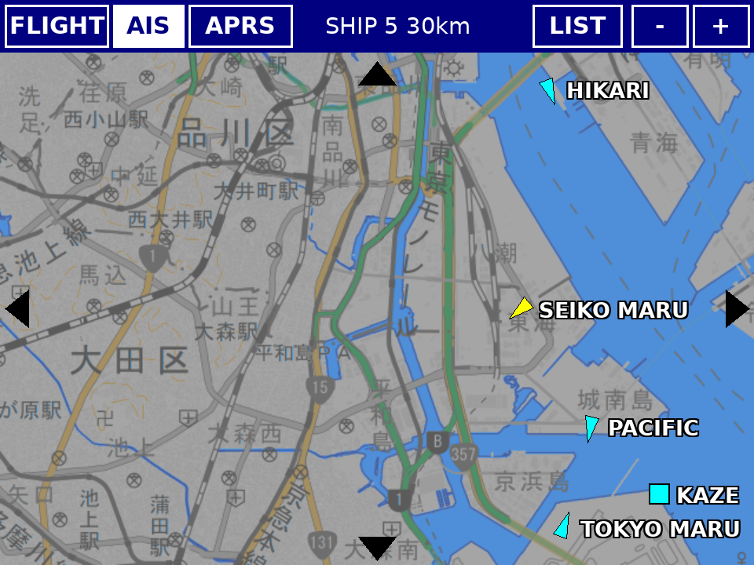
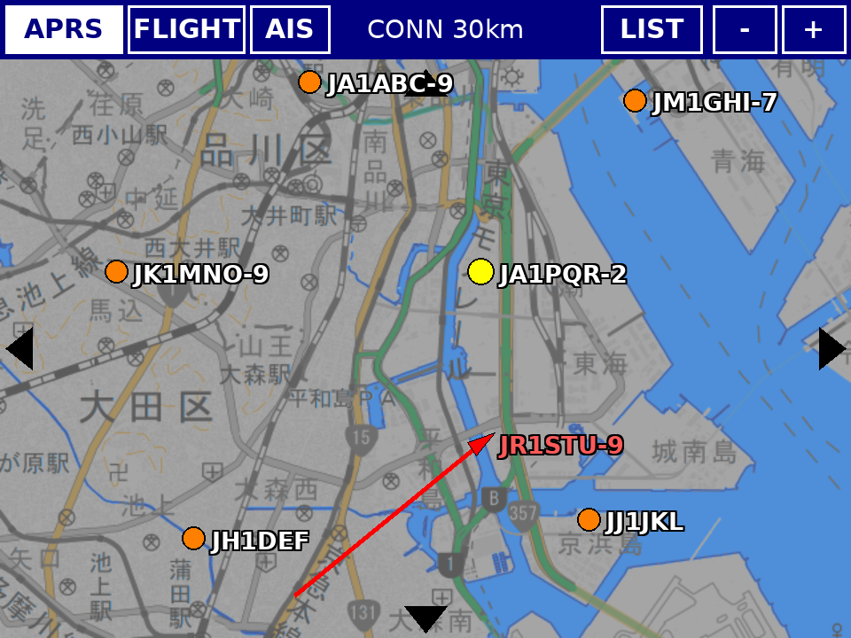
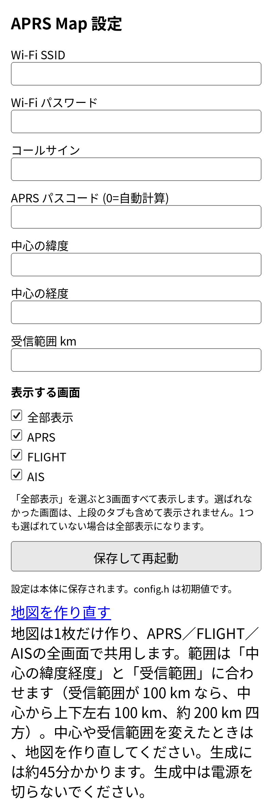

# APRSマップビューア（ESP32-S3 Super Mini＋TFTモジュール版）

ESP32-S3 Super Mini と、別体の SPI TFT モジュール（2.8インチ ILI9341 系・抵抗膜タッチ付き、または 3.5インチ ILI9488・480×320）で動く、APRS・航空機・船舶のマップ表示機です。
本体だけで地図を自動生成する機能を備えています。

CYD（基板一体型）ではなく、ESP32-S3 Super Mini と LCD モジュールをジャンパ線で配線する構成です。配線は下の「[ハードウェアと配線](#ハードウェアと配線)」を見てください。

ファームウェア版数: **S3 v28（タッチ版）／S3 v29b（ボタン版）／S3 v40（3.5インチ・ボタン版）／S3 v40t（3.5インチ・タッチ版）**（スプラッシュ表示で確認できます）

## 画面

| FLIGHT | AIS | APRS |
|---|---|---|
|  |  |  |

※ 画面例は実機の表示を再現したイメージです（地図は国土地理院の地理院タイル「淡色地図」、局・航空機・船舶はサンプルデータ）。

| 画面 | 内容 |
|---|---|
| FLIGHT | ADS-B 航空機（adsb.lol／adsb.fi、30秒ごとに取得） |
| AIS | AIS 船舶（Open Waters のスナップショット、60秒ごとに取得・APIキー不要） |
| APRS | APRS-IS から受信した APRS 局（APRS-IS: rotate.aprs2.net） |

地図は3画面で1枚を共用し、本体が生成して内蔵フラッシュに保存するため、SDカードは不要です。

**表示する画面は設定で選べます**（後述）。選ばなかった画面は、上段のタブも含めて表示されません。

上段のタブの並びは **FLIGHT → AIS → APRS** で、起動時は FLIGHT 画面が開きます。FLIGHT を非表示にしている場合は、タブの並び順で次に表示可能な画面（AIS → APRS）が起動画面になります。

## 特徴

- **地図の自動生成**: 地図が無い状態で起動すると、国土地理院の地理院タイル（淡色地図）を本体がダウンロードし、設定した中心と受信範囲に合わせた 640×480 のカラー地図を生成、専用フラッシュ領域に保存します。生成には約45分かかります（電源を切ると最初からやり直し）
- **このリポジトリの内蔵地図データは空です**: `include/maps_data.h` は意図的に空にしてあります。地図は必ず本体生成で作ってください（初回は Wi-Fi 等の設定後に自動で始まります）
- **中心を変えただけでは作り直しません**: 保存済みの地図はそのまま使われます。作り直したいときは、ポータルの「地図を作り直す」から手動で実行してください
- 生成した地図にはヘッダのバックアップコピーが付き、電源再投入で読み取れなくなっても自動復旧します。生成・有効化に失敗した場合は、理由が次回起動時の MAP DIAG 画面に表示されます
- 初期設定はスマホから（セットアップ用AP「APRSMap-Setup」→ ブラウザのフォーム）。設定は本体の NVS に保存され、`config.h` は初期値（種）です
- 受信した局は電源を切っても保持され、次回起動時に復元されます
- マーカーは画面ごとに色が違い、APRSはオレンジ、FLIGHTは明るい緑、AISはシアン（選択中は黄色）。ラベルは黒い縁取り付きで、地図の上でも読みやすくしています
- 表示していない画面の通信は止まります（ADS-Bの取得はFLIGHT画面、AISの取得はAIS画面の表示中だけ動き、タブを開いたときにすぐ取得します）
- AIS は Open Waters（aiscast）のスナップショット方式です。複数のAISネットワークを集約したデータを APIキーなしで取得します（位置は数分前のもののことがあります）
- 設定ポータルは通常動作中は止まっています。設定を変えたいときは、本体の **BOOT ボタンを2秒長押し**するとポータルが起動します（本体が Wi-Fi アクセスポイント「APRSMap-Setup」になり、スマホで接続すると設定画面が開きます。もう一度2秒長押しするまで止まりません）
- FLIGHT の航空機には、過去の位置を結んだ約1 cmの軌跡を表示します（取得ごとの位置を最大6点）
- ADS-B は2つの配信（adsb.lol と adsb.fi）に対応し、片方が失敗したり0機を返したときは、もう一方から取り直します（取れた方を次回先に試します）
- 表示していない画面のネットワーク更新は行いません（FLIGHT・AIS はその画面を表示している間だけ取得・接続します）
- 移動中のAPRS局は赤い三角形＋過去10分の赤い軌跡で表示します（10分以内に100m以上移動した局。止まって10分経つとオレンジの丸に戻ります。選択中は黄色のままです）
- 画面のちらつき対策として、変化のないマーカーの再描画をスキップします

## ハードウェアと配線

### 必要なもの

- ESP32-S3 Super Mini（フラッシュ 4MB、PSRAM なしで動作します）
- 2.8インチ TFT SPI モジュール 240×320（ILI9341 系、抵抗膜タッチ付き。「240xRGBx320 V1.1」と印刷された赤い基板のモジュールで確認しています）
- 3.5インチ TFT SPI モジュール 480×320（ILI9488 互換、タッチなし。「3.5" TFT SPI 480X320 V1.0」と印刷された赤い基板のモジュールで確認しています。ボタン操作で使います。下の「3.5インチモジュール」参照）
- 5V 電源（USB 給電で可）

ESP32-S3 Super Mini は GPIO1〜13 のみ引き出されている基板です。この範囲で収まるようにピン割り当てをしてあります（`include/LGFX_S3.h`）。

### 表示側の配線（LCD モジュール表示ヘッダ → ESP32-S3）

| LCD モジュール | ESP32-S3 |
|---|---|
| VCC | 5V（モジュールのレギュレータ使用。ジャンパ J1 がオープンの場合） |
| GND | GND |
| CS | GPIO10 |
| RESET | GPIO8 |
| DC | GPIO9 |
| SDI (MOSI) | GPIO11 |
| SCK | GPIO12 |
| LED | 3.3V（モジュール上のトランジスタ経由。バックライトの明るさ調整はできません） |
| SDO (MISO) | GPIO13 |

### タッチ側の配線（LCD モジュールタッチヘッダ → ESP32-S3）

タッチは表示とは別の SPI バスで接続します。

| LCD モジュール | ESP32-S3 |
|---|---|
| T_CLK | GPIO6 |
| T_CS | GPIO2 |
| T_DIN | GPIO5 |
| T_DO | GPIO4 |
| T_IRQ | GPIO1 |

モジュールの SD カードスロットは使いません（SD_CS は未接続）。

タッチなしモジュールでは、タッチ用のピン（GPIO1・2・4・5・6）が空くため、GPIO4〜7 に4つのボタンを付けて操作できます（下の「ボタン操作」参照）。タッチ版とボタン版は同じソースからビルドします。

### このモジュールでの注意点

- **電源**: VCC は 5V で供給してください。J1 がオープンの状態で 3.3V を入れると、レギュレータの電圧降下でパネル側が約 2.2V まで落ちて動作しません。3.3V で使う場合は J1 をショートしてレギュレータをバイパスしてください
- **色のバイトスワップ**: このパネルは `pushImage` の RGB565 がバイトスワップされて表示されます（fill の色は正常）。生成したカラー地図はバイトスワップした形で保存し、読み出し時に戻す実装になっています（`src/main.cpp` の `panelPack565` / `colorAt()`）。別のモジュールで色がずれる場合は、この2か所の変換をモジュールに合わせて直してください
- **タッチの向き**: このモジュールでは X 軸だけが反転していました。`src/main.cpp` の `readTouchConfirmed()` 内で `sx = 319 - x` の反転を入れています。別のモジュールで左右・上下が逆になる場合は、ここの変換を直してください
- パネルの ID 読み取り（SDO 経由）はこの構成では機能しませんでした。コントローラの判別はモジュールの仕様・印刷で確認してください

### 3.5インチモジュール（ILI9488・480×320）

赤基板の 3.5インチ SPI モジュール（「3.5" TFT SPI 480X320 V1.0」と印刷、タッチなし、裏面に SD スロットあり・未使用）向けの variant（S3 v40）です。表示の配線は 2.8インチ機と同一（SCK=GPIO12 / MOSI=GPIO11 / MISO=GPIO13 / DC=GPIO9 / CS=GPIO10 / RST=GPIO8）で、操作はボタン版（A=GPIO4 / B=GPIO5 / C=GPIO6 / D=GPIO7、内部プルアップ）です。環境 `esp32-s3-supermini-35` でビルドします（`-DLCD35=1`、スプラッシュ表示は "S3 v40"）。タッチ付きの 3.5インチモジュール用には環境 `esp32-s3-supermini-35touch`（`-DLCD35=1` のみ、タッチ配線は 2.8インチ版と同じ。スプラッシュ表示は "S3 v40t"）もあります。

- 画面は 480×320 フル対応です（バー・LIST は 16 行表示・詳細パネルも 480×320 化）。地図は 640×480 のままなので、最広角は **×0.75 のカバー表示**になります（バー表示は ×0.8、上下端が少し切れます。ズームは ×0.75 / ×1.0 / ×1.5 / ×2.0 / ×2.5 / ×3.0 の6段階）
- SPI 書き込み 40 MHz、読み出し 6 MHz。invert=false、rgb_order=false、rotation 1（横向き）
- パネルの ID 読み取りは 00 00 00（2.8インチ機と同じく SDO が生きていないため、型番の直接確認はできません）
- **色の注意点**: このパネルは LGFX が 24bit（RGB888）モードで駆動します。RGB565 の `pushImage` では淡い中間色がピンク化するため（ガンマやチャンネル回転では直りません）、地図の描画だけ RGB888 で直接送っています（`src/main.cpp` の `pushMap565`）。`lgfx::rgb888_t` のメモリ並びは **B,G,R** 順なので、変換時はその順で書くこと。2.8インチ機のバイトスワップはこのパネルでは不要です

## タッチ操作

| 操作 | 動作 |
|---|---|
| 上部バーのタブ | FLIGHT / AIS / APRS 画面の切り替え（表示設定した画面のみ） |
| [−] [＋] ボタン（右上） | ズーム変更 ×0.5 / ×1.0 / ×1.5 / ×2.0 / ×2.5 / ×3.0 の6段階。起動時は ×0.5（全画面共通） |
| LIST ボタン（右上、[−] の左隣） | 受信中の一覧を開く。一覧の行をタップすると中央表示＋詳細 |
| 局・航空機・船をタップ | その対象を中央に表示して一段ズームイン |
| 選択中の対象をもう一度タップ | 詳細表示（もう一度タップで閉じる） |
| 画面の端をタップ | その方向へ地図をスクロール（パン）。端の黒い三角が目印 |

## ボタン操作（タッチなし液晶用）

タッチパネルのない液晶モジュール向けの variant（S3 v29b）です。ボタンは押すと GND に落ちる結線で、本体の内部プルアップを使います（抵抗不要）。GPIO3 はストラッピングピンのため使っていません。BOOT（GPIO0）は従来どおりポータル起動と設定リセット専用です。

| ボタン | 配線 | 短押し | 長押し（0.6秒） |
|---|---|---|---|
| A | GPIO4 | FLIGHT へ（同じ画面でもう一度押すと LIST） | ズーム − |
| B | GPIO5 | AIS へ（同上） | ズーム ＋ |
| C | GPIO6 | APRS へ（同上） | 前の対象を選択 |
| D | GPIO7 | 次の対象を選択（中央表示＋一段ズームイン） | 詳細を開く／閉じる |

- 非表示に設定した画面のボタンは、タブの並び順で次の表示可能な画面へ飛びます（タッチ版と同じ規則）
- 地図のスクロール（パン）はボタンでは用意せず、対象を選ぶと中央に来る方式です
- LIST 表示中：A＝上へ / B＝下へ（押し続けで連続スクロール、カーソル行は黄色で反転）/ C＝決定（中央表示して詳細へ）/ D＝閉じる
- 詳細表示中：短押しで閉じます（A・B・C はその画面へ切り替えもします）

### 設定リセット

電源を入れてスプラッシュが表示された直後に **BOOT（GPIO0）を2秒長押し**すると、保存済み設定を消去してセットアップモードで起動します。

## ビルドと書き込み

PlatformIO プロジェクトです。

1. このフォルダを PlatformIO（VS Code）で開く
2. `include/config.h` の初期値（Wi-Fi・コールサイン・中心座標）を自分の環境に合わせて書き換える
3. そのまま Upload

タッチなし液晶用のボタン版は、環境 `esp32-s3-supermini-btn` でビルドします（`-DBUTTON_UI=1`、タッチドライバは含まれません。スプラッシュ表示は "S3 v29b"）。3.5インチ ILI9488 モジュール用は環境 `esp32-s3-supermini-35` でビルドします（`-DLCD35=1`、ボタン版を継承。スプラッシュ表示は "S3 v40"）。書き込みはアプリ版を 0x10000 へ。

依存ライブラリは LovyanGFX のみで、`platformio.ini` の `lib_deps` で自動取得されます（タッチも LovyanGFX 内蔵の XPT2046 ドライバを使います）。PNG 解読用の pngle / miniz は `src/pngle/` に同梱しています。

パーティションは `partitions_mapgen.csv`（4MB フラッシュ用：アプリ 0x1D0000 ＋ 地図保存領域 mapdata 0x210000）を使います。

> **注意:** パーティション構成が標準と異なるため、旧構成のファームから初めて書き込む場合は合体イメージを 0x0 から書く等でパーティションテーブルごと更新してください。その際、本体の設定（Wi-Fi・コールサイン・保存済みの局）は消えます。通常の PlatformIO アップロード（アプリのみ更新）では消えません。

## 設定項目（スマホのフォーム）
最初はwifiが設定されていませんのでその画面で停止します。
その時同じwifiにつながっているスマホから、wifiを検索すると設定画面のポータルが出てきますので、そこに接続してまずwifiのアクセスポイントとパスワードと地図のエリア範囲だけ入れて、保存して再起動させてください。
地図は最初は空の状態なので作成にはります。

完了すれば自動的に再起動されて地図が表示されるはずです。
あとから設定を変えるときは、本体のBOOTボタンを2秒長押しすると設定画面が表示されます（画面にURLが出ます）。その状態でスマホのwifiを検索すると「APRSMap-Setup」が出てきますので、そこに接続すると設定画面が表示されます。そこで下記の設定をやると楽です。

Wi-Fi SSID / パスワード、コールサイン、APRS パスコード（0 = 自動計算）、中心の緯度・経度、受信範囲 km、**表示する画面**。

### 表示する画面の選択

フォームの「表示する画面」で、使う画面だけを選べます。

- 「全部表示」にチェックすると FLIGHT / AIS / APRS の3画面すべてを表示
- 個別に選ぶ場合は、表示したい画面だけにチェック
- 選ばなかった画面は、本体の上段タブも含めて一切表示されません
- 1つも選ばれていない場合は全部表示になります

設定画面（未入力の状態）:

## 地図について

本体内で生成される地図は、国土地理院の地理院タイル（淡色地図）をもとに作成したカラー地図です。設定した中心と受信範囲に合わせて、本体がタイルをダウンロードして 640×480 の画像に合成し、専用フラッシュ領域に保存します。

このリポジトリの `include/maps_data.h`（内蔵の予備地図データ）は、地図データを同梱しないため意図的に空にしてあります。地図が無い状態で起動すると自動で生成が始まります（Wi-Fi 設定が必要です）。中心や受信範囲を変えたときは、ポータルの「地図を作り直す」から作り直してください。
