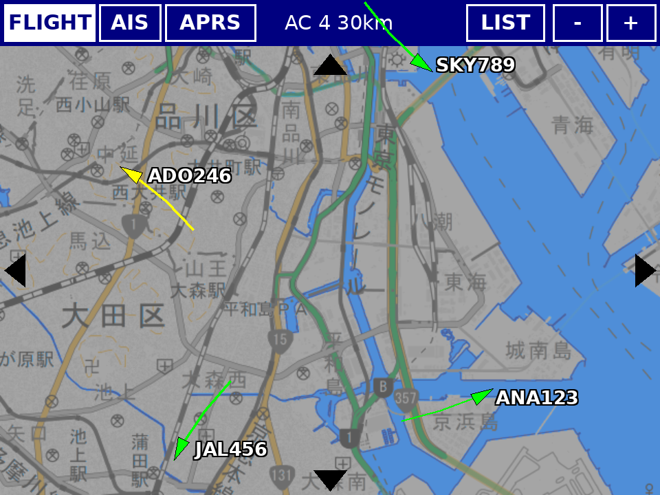

# APRSマップビューア（ESP32-S3 Super Mini＋2.8インチTFTモジュール版）

ESP32-S3 Super Mini と、別体の 2.8 インチ SPI TFT モジュール（ILI9341 系・抵抗膜タッチ付き）で動く、APRS・航空機・船舶のマップ表示機です。
本体だけで地図を自動生成する機能を備えています。

CYD（基板一体型）ではなく、ESP32-S3 Super Mini と LCD モジュールをジャンパ線で配線する構成です。配線は下の「[ハードウェアと配線](#ハードウェアと配線)」を見てください。

ファームウェア版数: **S3 v9**（スプラッシュ表示 "APRS Map Viewer S3 v9" で確認できます）

## 画面

| APRS | FLIGHT | AIS |
|---|---|---|
|  |  |  |

※ 画面例は実機の表示を再現したイメージです（地図は国土地理院の地理院タイル「淡色地図」、局・航空機・船舶はサンプルデータ）。

| 画面 | 内容 |
|---|---|
| APRS | APRS-IS から受信した APRS 局（APRS-IS: rotate.aprs2.net） |
| FLIGHT | ADS-B 航空機（adsb.lol、60秒ごとに取得） |
| AIS | AIS 船舶（aisstream.io、APIキーが必要） |

地図は3画面で1枚を共用し、本体が生成して内蔵フラッシュに保存するため、SDカードは不要です。

**表示する画面は設定で選べます**（後述）。選ばなかった画面は、上段のタブも含めて表示されません。

## 特徴

- **地図の自動生成**: 地図が無い状態で起動すると、国土地理院の地理院タイル（淡色地図）を本体がダウンロードし、設定した中心と受信範囲に合わせた 640×480 のカラー地図を生成、専用フラッシュ領域に保存します。生成には約45分かかります（電源を切ると最初からやり直し）
- **このリポジトリの内蔵地図データは空です**: `include/maps_data.h` は意図的に空にしてあります。地図は必ず本体生成で作ってください（初回は Wi-Fi 等の設定後に自動で始まります）
- **中心を変えただけでは作り直しません**: 保存済みの地図はそのまま使われます。作り直したいときは、ポータルの「地図を作り直す」から手動で実行してください
- 生成した地図にはヘッダのバックアップコピーが付き、電源再投入で読み取れなくなっても自動復旧します。生成・有効化に失敗した場合は、理由が次回起動時の MAP DIAG 画面に表示されます
- 初期設定はスマホから（セットアップ用AP「APRSMap-Setup」→ ブラウザのフォーム）。設定は本体の NVS に保存され、`config.h` は初期値（種）です
- 受信した局は電源を切っても保持され、次回起動時に復元されます
- マーカーは3画面ともオレンジ色で統一（選択中は黄色）。ラベルは黒い縁取り付きで、地図の上でも読みやすくしています
- 移動中のAPRS局は赤い三角形＋過去10分の赤い軌跡で表示します（10分以内に100m以上移動した局。止まって10分経つとオレンジの丸に戻ります。選択中は黄色のままです）
- 画面のちらつき対策として、変化のないマーカーの再描画をスキップします

## ハードウェアと配線

### 必要なもの

- ESP32-S3 Super Mini（フラッシュ 4MB、PSRAM なしで動作します）
- 2.8インチ TFT SPI モジュール 240×320（ILI9341 系、抵抗膜タッチ付き。「240xRGBx320 V1.1」と印刷された赤い基板のモジュールで確認しています）
- 5V 電源（USB 給電で可）

ESP32-S3 Super Mini は GPIO1〜13 のみ引き出されている基板です。この範囲で収まるようにピン割り当てをしてあります（`include/LGFX_S3.h`）。

### 表示側の配線（LCD モジュール表示ヘッダ → ESP32-S3）

| LCD モジュール | ESP32-S3 |
|---|---|
| VCC | 5V（モジュールのレギュレータ使用。ジャンパ J1 がオープンの場合） |
| GND | GND |
| CS | GPIO10 |
| RESET | GPIO8 |
| DC | GPIO9 |
| SDI (MOSI) | GPIO11 |
| SCK | GPIO12 |
| LED | 3.3V（モジュール上のトランジスタ経由。バックライトの明るさ調整はできません） |
| SDO (MISO) | GPIO13 |

### タッチ側の配線（LCD モジュールタッチヘッダ → ESP32-S3）

タッチは表示とは別の SPI バスで接続します。

| LCD モジュール | ESP32-S3 |
|---|---|
| T_CLK | GPIO6 |
| T_CS | GPIO2 |
| T_DIN | GPIO5 |
| T_DO | GPIO4 |
| T_IRQ | GPIO1 |

モジュールの SD カードスロットは使いません（SD_CS は未接続）。

### このモジュールでの注意点

- **電源**: VCC は 5V で供給してください。J1 がオープンの状態で 3.3V を入れると、レギュレータの電圧降下でパネル側が約 2.2V まで落ちて動作しません。3.3V で使う場合は J1 をショートしてレギュレータをバイパスしてください
- **色のバイトスワップ**: このパネルは `pushImage` の RGB565 がバイトスワップされて表示されます（fill の色は正常）。生成したカラー地図はバイトスワップした形で保存し、読み出し時に戻す実装になっています（`src/main.cpp` の `panelPack565` / `colorAt()`）。別のモジュールで色がずれる場合は、この2か所の変換をモジュールに合わせて直してください
- **タッチの向き**: このモジュールでは X 軸だけが反転していました。`src/main.cpp` の `readTouchConfirmed()` 内で `sx = 319 - x` の反転を入れています。別のモジュールで左右・上下が逆になる場合は、ここの変換を直してください
- パネルの ID 読み取り（SDO 経由）はこの構成では機能しませんでした。コントローラの判別はモジュールの仕様・印刷で確認してください

## タッチ操作

| 操作 | 動作 |
|---|---|
| 上部バーのタブ | APRS / FLIGHT / AIS 画面の切り替え（表示設定した画面のみ） |
| [−] [＋] ボタン（右上） | ズーム変更 ×0.5 / ×1.0 / ×1.5 / ×2.0 / ×2.5 / ×3.0 の6段階。起動時は ×0.5（全画面共通） |
| LIST ボタン（右上、[−] の左隣） | 受信中の一覧を開く。一覧の行をタップすると中央表示＋詳細 |
| 局・航空機・船をタップ | その対象を中央に表示して一段ズームイン |
| 選択中の対象をもう一度タップ | 詳細表示（もう一度タップで閉じる） |
| 画面の端をタップ | その方向へ地図をスクロール（パン）。端の黒い三角が目印 |

### 設定リセット

電源を入れてスプラッシュが表示された直後に **BOOT（GPIO0）を2秒長押し**すると、保存済み設定を消去してセットアップモードで起動します。

## ビルドと書き込み

PlatformIO プロジェクトです。

1. このフォルダを PlatformIO（VS Code）で開く
2. `include/config.h` の初期値（Wi-Fi・コールサイン・中心座標）を自分の環境に合わせて書き換える
3. そのまま Upload

依存ライブラリは LovyanGFX のみで、`platformio.ini` の `lib_deps` で自動取得されます（タッチも LovyanGFX 内蔵の XPT2046 ドライバを使います）。PNG 解読用の pngle / miniz は `src/pngle/` に同梱しています。

パーティションは `partitions_mapgen.csv`（4MB フラッシュ用：アプリ 0x1D0000 ＋ 地図保存領域 mapdata 0x210000）を使います。

> **注意:** パーティション構成が標準と異なるため、旧構成のファームから初めて書き込む場合は合体イメージを 0x0 から書く等でパーティションテーブルごと更新してください。その際、本体の設定（Wi-Fi・コールサイン・AISキー・保存済みの局）は消えます。通常の PlatformIO アップロード（アプリのみ更新）では消えません。

## 設定項目（スマホのフォーム）
最初はwifiが設定されていませんのでその画面で停止します。
その時同じwifiにつながっているスマホから、wifiを検索すると設定画面のポータルが出てきますので、そこに接続してまずwifiのアクセスポイントとパスワードと地図のエリア範囲だけ入れて、保存して再起動させてください。
地図は最初は空の状態なので作成にはります。

完了すれば自動的に再起動されて地図が表示されるはずです。
wifi接続中は http://aprs-map.local にすると設定画面が表示されます。そこで下記の設定をやると楽です。

Wi-Fi SSID / パスワード、コールサイン、APRS パスコード（0 = 自動計算）、中心の緯度・経度、受信範囲 km、AIS APIキー（aisstream.io の無料キー）、**表示する画面**。

### 表示する画面の選択

フォームの「表示する画面」で、使う画面だけを選べます。

- 「全部表示」にチェックすると APRS / FLIGHT / AIS の3画面すべてを表示
- 個別に選ぶ場合は、表示したい画面だけにチェック
- 選ばなかった画面は、本体の上段タブも含めて一切表示されません
- 1つも選ばれていない場合は全部表示になります

設定画面（未入力の状態）:

## 地図について

本体内で生成される地図は、国土地理院の地理院タイル（淡色地図）をもとに作成したカラー地図です。設定した中心と受信範囲に合わせて、本体がタイルをダウンロードして 640×480 の画像に合成し、専用フラッシュ領域に保存します。

このリポジトリの `include/maps_data.h`（内蔵の予備地図データ）は、地図データを同梱しないため意図的に空にしてあります。地図が無い状態で起動すると自動で生成が始まります（Wi-Fi 設定が必要です）。中心や受信範囲を変えたときは、ポータルの「地図を作り直す」から作り直してください。
